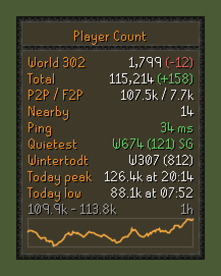
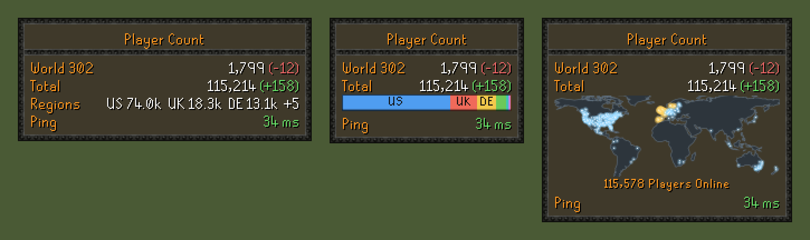
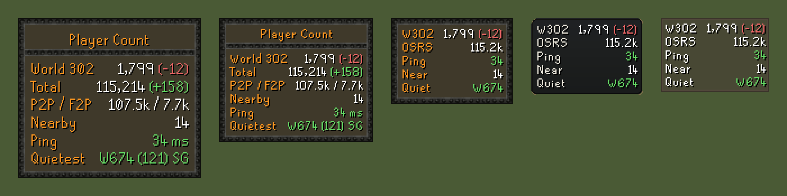
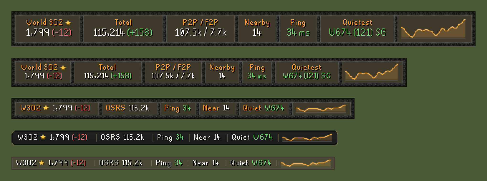
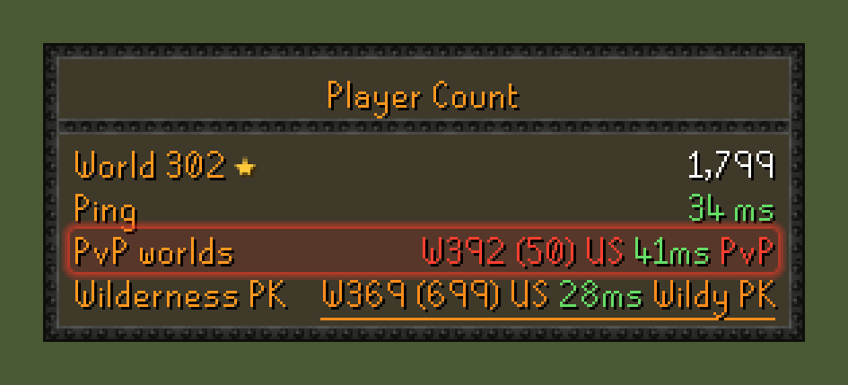
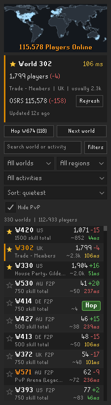

# Player Count


A movable overlay for Old School RuneScape showing how many people are on your world and in the
whole game, plus a world finder, a live world list in the sidebar, ping, alerts and population
history.



## Overlay

- **Your world's player count** and the **OSRS total**, each with its change over the last minute
  (green for gains, red for losses).
- Numbers update in place: the overlay keeps a steady width instead of shifting as digits change.
- **Ping** to your world, **players nearby**, and how many **friends and clan members** are on your
  world.
- **Members / F2P split**.
- **Regions** (US, UK, DE, AU and more), shown as one line each, the top regions on one line, a
  colour **share bar**, or a **world map** of glowing player dots clustered where each region's
  players are. Hover a region on the map for its player count, share and number of worlds.

  
- **Activity worlds**: type activities like `Wintertodt, Tempoross` and see the busiest world for each.
- **Daily records**: today's peak and low OSRS total, and when they happened.
- **Population graph** of the OSRS total or your current world over the last 1–6 hours. History is
  saved between sessions.
- **Three frame styles**: the game's own steel interface border, RuneLite's standard box, or a dark
  panel.
- **Vertical or horizontal layout**: a list, or a strip of labelled cells for the top or bottom of the
  screen.
- **Three sizes**: **Full**, **Medium** (the game's small font) and **Small** (short labels on one
  line). Each is drawn at native size, so text stays pixel-sharp. Hold Alt and drag to move the overlay,
  or drag its corner to switch size.
- **Click to hop**: click the suggested world or an activity world in the overlay to hop there. You
  can also right-click the overlay for Hop and Next world.
- **Auto-hide** in combat, in instances (boss rooms, raids, minigames), or until you hover over it.


**Sizes:** Full, Medium and Small, shown enlarged 3x:





## World finder

Suggests a world and hops you there from a hotkey, the overlay's right-click menu, or the sidebar.

- Find the **quietest**, **busiest** or **lowest ping** world, cycle through **themed worlds**
  (your favourites, a skill-total level, or an activity), or turn the finder **off**.
- **Themed worlds**: pick an activity from a dropdown (Wintertodt, Tempoross, Guardians of the Rift,
  Trade, Nex, ToA, Soul Wars, House party, each skill-total level and every other themed world) and the finder rotates through
  every world running it, busiest first, lowest ping first, or both. The sidebar has the same Theme
  filter. Themed is the only mode that can
  suggest PvP, high-risk, Bounty Hunter, Deadman, Leagues, beta, speedrun or fresh-start worlds. PvP and
  Deadman worlds, where you can be attacked almost anywhere, **pulse red** in the overlay and
  sidebar. Other PvP-themed worlds (High Risk, Bounty Hunter, Wilderness PK, LMS, PvP Arena) and
  separate-account worlds show in **orange with an orange underline**. That applies wherever a world
  appears: the world you're on, the suggestion, activity worlds and the sidebar. Chat warns you as you
  hop. You can turn the warnings off.

  
- **Favourites**: the first theme. List worlds in the settings (`302, 330, 420`) or star them in the
  sidebar. One **Order** setting covers favourites and themes: busiest, quietest, lowest ping, busy +
  low ping, or quiet + low ping. **Next world** cycles through them in that order and starts over
  after the last one. A **gold star** beside your world in the
  overlay means you're on a favourite.
- Filters: membership, region, **max ping**, and skill-total worlds you have the level for.
- **Skip recent worlds** you were on in the last X minutes.
- **Prefer usually quiet**: over a few days of use it learns how busy each world usually is at each
  hour, and weighs that in alongside the current count.
- **Next world hotkey**: each press hops to the next world on the list, skipping ones it already took
  you to. Good for star hunting, rune rocks and other world-hopping loops.
- Never suggests PvP, high-risk, Deadman, seasonal, beta, tournament or nearly full worlds.

## Sidebar

 

- A **world map** of glowing players at the top. Hover a region to see how many people are playing
  there.
- Your world at a glance: players, change, activity, region, how busy it usually is, and ping.
- **Hop to suggested** and **Next world** buttons.
- Every world with live players, change, ping and its usual count at this hour.
- **Search** by world number or activity. The **Filters** button opens membership, region, theme
  (including Favourites), sort and Hide PvP, and shows how many filters are on, e.g. "Filters (2)".
- **Favourites**: click the star to favourite a world; favourites stay at the top.
- **Hop** button on the row you hover over, or double-click a world (or press Enter). Right-click for
  more options.

## Alerts and chat

- Notifications when your world gets busy or quiet, or when a player arrives nearby. Each uses
  RuneLite's notification settings (click the cog for a screen flash in any colour, a sound, a tray
  popup or a chat message).
- **Player arrives** options for PKers and skillers: alert for the first arrival or every new player,
  only within X tiles, ignore friends and clan, or only players who **can attack you** (Wilderness
  level and PvP-world combat ranges, Deadman). The alert names them, e.g. "Zezima (lvl-112, skulled)
  arrived 6 tiles away", and they're **outlined** in your chosen colour for a few seconds.
- Type `::players` in chat for a quick summary.

## Settings

Settings are grouped so you only open what you need:

- **Overlay**: frame style, background opacity, size, layout (vertical or horizontal), auto-hide.
- **Overlay lines**: what the overlay shows, including change (+/-), regions and the graph.
- **World finder**: what to find, theme, favourite worlds, order, risky-world warnings and hotkeys.
- **Finder filters** (collapsed): membership, region, max ping, skill total worlds, skip recent worlds,
  prefer usually quiet.
- **World alerts**: notifications when your world gets busy or quiet, with the thresholds.
- **Player arrives**: the arrival alert and its range, filters and highlight.
- **Sidebar & data** (collapsed): sidebar, world map, `::players`, refresh rate and ping.

## Data and network use

- **Player counts** come from Jagex's live world list (`www.runescape.com/g=oldscape/slr.ws`), the
  same list the in-game world switcher uses. It's downloaded every 30 seconds by default (5 seconds
  minimum). If it can't be reached, the plugin falls back to RuneLite's own world list, which updates
  every 10 minutes.
- **Ping** is measured by briefly opening a connection to each world server's game port, the way
  RuneLite's World Hopper does. Your current world is checked every 3 seconds (adjustable), favourites
  every 20 seconds, and every world one at a time every 2 minutes. Ping is colour-coded: green under
  80 ms, amber under 150 ms, red above. You can turn ping off in the Data settings.
- **Population history** and **usual counts** are stored locally in `~/.runelite/player-count/`.
  Nothing is sent anywhere.

## Building

Requires JDK 11.

```
./gradlew build      # compile and run the tests
./gradlew run        # start a RuneLite dev client with the plugin loaded
```

The README screenshots are rendered without the client:

```
./gradlew showcase -Psprites=<folder of exported sprites> -Pout=docs
```

The steel frame uses the game's steel-border sprites (`310`–`315` and `2546`), which the plugin
loads from the game at runtime. To render the screenshots, export those sprites from your game cache
as PNGs named `<id>_0.png`.

## Credits

The world map outline is made with [Natural Earth](https://www.naturalearthdata.com/) (public domain).

## License

BSD 2-Clause. See [LICENSE](LICENSE).
