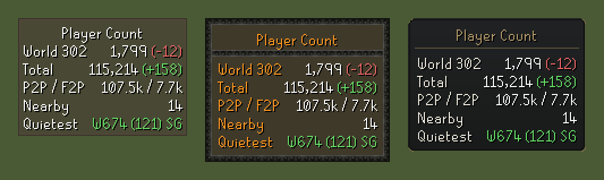
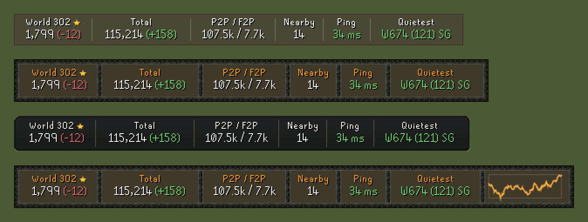
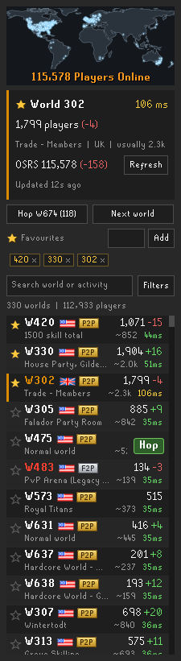

# Player Count


A movable overlay for Old School RuneScape showing how many people are on your world and in the
whole game, plus a world finder, a live world list in the sidebar, ping, alerts and population
history.


## Overlay

- **Your world's player count** and the **OSRS total**, each with its change over the last minute
  (green for gains, red for losses).
- **Ping** to your world, **players nearby**, and how many **friends and clan members** are on your
  world.
- **Members / F2P split** and a **per-region breakdown** (US, UK, DE, AU and more).
- **Activity worlds**: type activities like `Wintertodt, Tempoross` and see the busiest world for each.
- **Daily records**: today's peak and low OSRS total, and when they happened.
- **Population graph** of the OSRS total or your current world over the last 1–6 hours. History is
  saved between sessions.
- **Three frame styles**: the game's own steel interface border, RuneLite's standard box, or a dark
  panel.
- **Vertical or horizontal layout**: a list, or a strip of labelled cells for the top or bottom of the
  screen.
- **Drag and resize**: hold Alt and drag to move it, or drag its corner to resize it. There's also a
  Size setting (60–300%). Text is never shrunk, since that blurs the game's pixel font. Smaller sizes
  switch to a **compact** layout (the game's small font) and then **mini** (short labels on one line),
  so everything stays pixel-sharp. Larger sizes scale up.
- **Click to hop**: click the suggested world or an activity world in the overlay to hop there. You
  can also right-click the overlay for Hop and Next world.
- **Auto-hide** in combat, in instances (boss rooms, raids, minigames), or until you hover over it.





**Sizes:** normal, compact and mini, shown enlarged 3x:


## World finder

Suggests a world and hops you there from a hotkey, the overlay's right-click menu, or the sidebar.

- Find the **quietest**, **busiest** or **lowest ping** world, or turn the finder **off**.
- Filters: membership, region, **max ping**, **favourites only**, and skill-total worlds you have the
  level for.
- **Skip recent worlds** you were on in the last X minutes.
- **Prefer usually quiet**: over a few days of use it learns how busy each world usually is at each
  hour, and weighs that in alongside the current count.
- **Next world hotkey**: each press hops to the next world on the list, skipping ones it already took
  you to. Good for star hunting, rune rocks and other world-hopping loops.
- Never suggests PvP, high-risk, Deadman, seasonal, beta, tournament or nearly full worlds.

## Sidebar



- Your world at a glance: players, change, activity, region, how busy it usually is, and ping.
- **Hop to suggested** and **Next world** buttons.
- Every world with live players, change, ping and its usual count at this hour.
- Search by world number or activity, filter by membership and region, and sort by quietest, busiest,
  lowest ping, usually quiet or world number.
- **Favourites**: click the star to favourite a world; favourites stay at the top.
- **Hop** button on the row you hover over, or double-click a world (or press Enter). Right-click for
  more options.

## Alerts and chat

- Notifications when your world gets busy or quiet, or when a player arrives nearby while you were
  alone. Each uses RuneLite's standard notification settings.
- Type `::players` in chat for a quick summary.

## Data and network use

- **Player counts** come from Jagex's live world list (`www.runescape.com/g=oldscape/slr.ws`), the
  same list the in-game world switcher uses. It's downloaded every 30 seconds by default (5 seconds
  minimum). If it can't be reached, the plugin falls back to RuneLite's own world list, which updates
  every 10 minutes.
- **Ping** is measured by briefly opening a connection to each world server's game port, the way
  RuneLite's World Hopper does. Your current world is checked every 3 seconds (adjustable), favourites
  every 20 seconds, and every world one at a time every 2 minutes. Ping is colour-coded: green under
  80 ms, amber under 150 ms, red above. You can turn ping off in the Data settings.
- **Population history** and **usual counts** are stored locally in `~/.runelite/player-count/`.
  Nothing is sent anywhere.

## Building

Requires JDK 11.

```
./gradlew build      # compile and run the tests
./gradlew run        # start a RuneLite dev client with the plugin loaded
```

The README screenshots are rendered without the client:

```
./gradlew showcase -Psprites=<folder of exported sprites> -Pout=docs
```

The steel frame uses the game's steel-border sprites (`310`–`315` and `2546`), which the plugin
loads from the game at runtime. To render the screenshots, export those sprites from your game cache
as PNGs named `<id>_0.png`.

## License

BSD 2-Clause. See [LICENSE](LICENSE).
